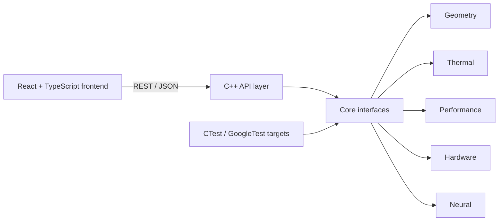

# NEXUS — Unified Engineering Workbench

NEXUS is a modular engineering R&D workbench with geometry inspection, thermal FEM, deterministic parallel benchmarking, manual neural backpropagation, and a simulated hardware bench.

## Current baseline

- C++17 API process with `GET /api/health` on configurable `127.0.0.1:8081` by default.
- React + TypeScript + Vite frontend on port 5173.
- Dark scientific-workbench design shell with module navigation.
- CMake/CTest build with focused tests for every completed module.
- Optional, version-pinned GoogleTest FetchContent configuration (`-DNEXUS_ENABLE_GTEST=ON`).

## Build the C++ service

```text
cmake -S . -B build -DNEXUS_BUILD_TESTS=ON
cmake --build build --config Release
ctest --test-dir build --output-on-failure
```

Run the service:

```text
./build/nexus-api 8081
```

The port can also be configured with `NEXUS_API_PORT`. A command-line port takes precedence:

```text
NEXUS_API_PORT=8081 ./build/nexus-api
```

Health endpoint:

```text
curl http://127.0.0.1:8081/api/health
```

It returns the application name/version, backend status, C++ standard and API status.

Then open `http://127.0.0.1:5173` after starting the frontend. The frontend reports the actual health response; it does not fabricate a connected state.

## Run the frontend

Requires Node.js 20 LTS or later.

```text
cd frontend
npm install
npm run dev
```

The frontend reads `VITE_API_BASE_URL`, defaulting to the Vite development proxy at `/api`. Copy `frontend/.env.example` to `frontend/.env.local` to use a direct backend URL:

```text
VITE_API_BASE_URL=http://127.0.0.1:8081
```

Troubleshooting:

- If 8080 is occupied, leave the unrelated process running and use the default 8081 or another available port.
- If the dashboard shows Backend Offline, confirm the C++ process is running and that `VITE_API_BASE_URL` matches its port.
- The dashboard reports timeout, connection, HTTP, and malformed-response errors from the centralized API client.

## One-click Windows launch

The Windows launcher and packaging instructions are documented in [docs/windows_packaging.md](docs/windows_packaging.md). GitHub Actions run #5 on commit `a261a03` successfully built and packaged the Windows x64 release, started the packaged backend, served the frontend, and passed all 11 API integration checks. The hosted runner did not perform an interactive double-click GUI test or a physical clean-machine test. The package uses `Launch.exe`, a bundled C++ backend, and bundled frontend assets; Node.js is not required on the evaluator machine.

## Source build and verification

```text
cmake -S . -B build -DNEXUS_BUILD_TESTS=ON -DNEXUS_ENABLE_GTEST=OFF
cmake --build build --config Release
ctest --test-dir build --output-on-failure
cd frontend
npm ci
npm run build
cd ..
python3 scripts/api_integration_test.py
```

The API integration script requires the backend to be running on port 8081. See [docs/test_results.md](docs/test_results.md) for the actual stabilization run and warning classification.

## Architecture



The API layer owns transport concerns only. Numerical engines will live under `core/` and remain independent of browser code. Sample data and generated results are kept separate from source.

## Thermal Studio

See [docs/thermal.md](docs/thermal.md) for the FEM formulation, boundary-condition treatment, midpoint error methodology, and verified mesh-convergence results. Build the solver and generate the numerical artifacts with:

```text
cmake --build build --config Release
./build/nexus-thermal-export results/thermal
```

The frontend Thermal Studio sends actual parameterized requests to `POST /api/thermal/solve`; the C++ response supplies the plotted temperatures, error, timing, and convergence rows.

## Geometry Lab

See [docs/geometry.md](docs/geometry.md) for the ASCII STL and temperature CSV contracts, parser validation, viewer behavior, provenance, and limitations. Geometry Lab is available from the frontend module navigation and uses the live C++ endpoints:

```text
POST /api/geometry/stl/parse
POST /api/geometry/csv/parse
```

Both endpoints accept JSON `{ "filename": "...", "content": "..." }`. The frontend's centralized client enforces the 2 MiB upload limit and timeout, while Three.js renders the returned triangles and temperature nodes. Use the checked-in fixtures at `data/geometry/sample_cube.stl` and `data/geometry/sample_temperature.csv`, or the in-app sample buttons, to verify the complete browser-to-C++ path.

## Performance Lab

See [docs/performance.md](docs/performance.md) for the workload generator, bounded C++ worker pool, benchmark methodology, numerical agreement, API contract, and limitations. Open Performance Lab from the frontend navigation and configure a deterministic benchmark.

```text
POST /api/performance/benchmark
```

Example payload:

```json
{"case_count":240,"mesh_size":40,"seed":20241031,"worker_counts":[1,2,4]}
```

Each worker configuration performs one warm-up and five measured repetitions. The UI displays actual median timings, speedup, efficiency, CPU metadata, numerical agreement, charts, and CSV export. Results are not hardcoded and the product does not claim a speedup unless measured values show one.

## Neural Lab

See [docs/neural.md](docs/neural.md) for the exact single-sample regression equations, manual chain-rule derivation, finite-difference validation, training behavior, and API contract. Neural Lab uses:

```text
POST /api/neural/backpropagation
```

The C++17 engine returns the forward pass, analytical gradients, simultaneous first update, central finite-difference table, 100-step loss history, final parameters, and final loss. The frontend renders those actual values and provides CSV export. No automatic differentiation or machine-learning framework is used.

## Hardware Studio

See [docs/hardware.md](docs/hardware.md) for the documented Arduino Nano RP2040 Connect, Digilent Basys 3, and SEGGER J-Link EDU Mini assumptions, architecture diagram, voltage/interface table, simulated adapter design, failure recovery, and safety limitations. Hardware Studio is explicitly simulated and does not access physical USB, serial, FPGA, SWD, or JTAG hardware.

The live C++ routes are:

```text
GET  /api/hardware/devices
POST /api/hardware/discover
POST /api/hardware/connect
POST /api/hardware/disconnect
POST /api/hardware/simulate-failure
POST /api/hardware/recover
GET  /api/hardware/telemetry
```

## Dependency record

See [docs/dependencies.md](docs/dependencies.md) for the initial version policy and source-build assumptions.

## Inputs and exports

- Geometry: ASCII STL and `node_id,x_m,y_m,z_m,temperature_C` CSV; sample data is under `data/geometry/`.
- Thermal: parameterized JSON requests; generated CSV/SVG artifacts are under `results/thermal/`.
- Performance: deterministic JSON workload configuration and CSV timing export.
- Neural: exact assignment JSON and CSV loss-history export.
- Hardware: no physical input; all devices and telemetry are explicitly simulated.

## Submission documents

- [Architecture](docs/architecture.md)
- [Requirements traceability](docs/requirements_traceability.md)
- [Test results](docs/test_results.md)
- [Performance](docs/performance.md)
- [Neural](docs/neural.md)
- [Hardware](docs/hardware.md)
- [Windows packaging](docs/windows_packaging.md)
- [Submission report](docs/submission_report.md)
- [Demo script](docs/demo_script.md)
- [AI usage log](docs/ai_usage_log.md)

After downloading and extracting the verified Windows artifact, create the candidate-named submission archive with:

```text
python3 scripts/create_submission_zip.py YOUR_CANDIDATE_ID --windows-package /path/to/extracted/NEXUS-Workbench-0.1.0-win64 --output-dir submission
```

The script rejects the placeholder identifier, refuses to overwrite an archive, validates required Windows files, and excludes `__MACOSX` metadata.

## Phase checklist

- Completed and verified: foundation, backend integration, Geometry Lab, Thermal Studio, Performance Lab, Neural Lab, and simulated Hardware Studio.
- Tested locally: clean CMake configure, C++ release build, six CTest targets, frontend production build, live API integration, static frontend serving, and browser navigation smoke test.
- Tested in GitHub Actions run #5: Windows x64 MSVC build, CTest, frontend build, CPack ZIP generation, required-entry validation, packaged backend startup, HTTP health/frontend delivery, 11/11 API integration checks, and artifact uploads.
- Not verified: interactive Windows GUI launch and physical clean-machine/offline evaluation.
- Manual deliverables still required: candidate identifier, handwritten backpropagation appendix, timestamped evidence bundle, and final archive creation.
