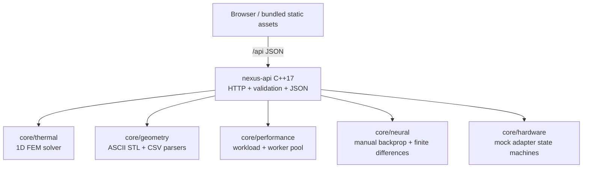

# NEXUS architecture

The repository is split by responsibility:

- `frontend/`: React presentation, navigation, charts, and API client code.
- `backend/api/`: HTTP transport, request validation, serialization, and controller composition.
- `core/`: browser-independent engineering engines and domain interfaces.
- `data/`: input fixtures and provenance notes.
- `results/`: reproducible generated outputs, never source-of-truth code.
- `tests/`: unit and integration test targets.
- `docs/`: architecture, dependency, verification, and report material.
- `scripts/`: reproducible build, test, export, and packaging helpers.
- `config/`: example configuration only; no credentials.

The C++ API owns transport, validation, JSON serialization, static frontend serving, and controller composition only. Each controller calls a focused core service, so the API is not the numerical implementation. Frontend modules consume typed JSON responses and display explicit loading, empty, error, and success states.

## Module boundaries and data flow

Thermal, performance, and neural numerical work is C++17. Geometry file parsing is C++17. Hardware is explicitly mocked in C++17. The React/TypeScript layer handles interaction, rendering, request cancellation, and CSV export of already-returned backend data; it does not compute engineering results.

The development browser uses Vite's `/api` proxy to port 8081. The Windows packaging path uses the same C++ API as a static server for `frontend/dist`, allowing the packaged browser session to run without Node.js or internet access.

The requirements audit is in [requirements_traceability.md](requirements_traceability.md); executed commands and evidence are in [test_results.md](test_results.md).
