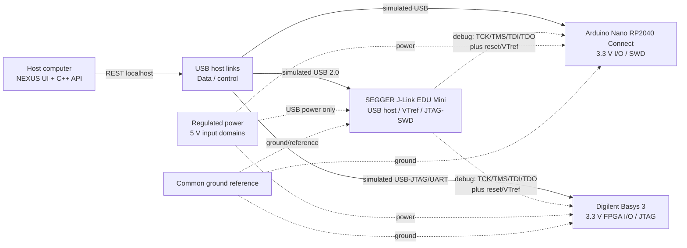

# Hardware Studio

Hardware Studio is a simulated host-connected engineering bench. It models device discovery, capabilities, connection state, telemetry, a reproducible connection-timeout failure, and recovery in C++17. It does not open USB, serial, SWD, JTAG, FPGA, or GPIO hardware.

## Representative devices and manufacturer references

The model uses one representative device from each relevant category, with claims limited to manufacturer documentation:

- Microcontroller: Arduino Nano RP2040 Connect. Arduino documents 3.3 V operation/I/O for Nano boards with radio modules, a 5–18 V VIN range for this board, USB device connectivity, and RP2040 SWD debug pads. References: [Arduino Nano RP2040 Connect](https://docs.arduino.cc/hardware/nano-rp2040-connect), [Arduino pinout PDF](https://docs.arduino.cc/resources/pinouts/ABX00053-full-pinout.pdf), [Arduino datasheet](https://docs.arduino.cc/resources/datasheets/ABX00053-datasheet.pdf).
- FPGA: Digilent Basys 3 (Artix-7 35T). The official reference manual documents USB-JTAG/UART on the Micro-AB J4 port, a 6-pin JTAG header J5, 5 V external power, and JTAG-based FPGA configuration. Reference: [Basys 3 Reference Manual](https://digilent.com/reference/_media/reference/programmable-logic/basys-3/basys3_rm.pdf).
- JTAG adapter: SEGGER J-Link EDU Mini. SEGGER documents USB 2.0 Full-Speed, a 9-pin 0.05-inch target connector, 1.8/3.3 V target interface voltage, USB power, and no target power supply. References: [J-Link EDU Mini specifications](https://www.segger.com/products/debug-probes/j-link/models/j-link-edu-mini/), [SEGGER VTref guidance](https://kb.segger.com/VTref), [J-Link EDU Mini connector notes](https://kb.segger.com/J-Link_EDU_Mini).

The J-Link is a debug probe, not a generic compute board. It translates host debug commands into JTAG/SWD transactions and observes target reference voltage; it does not replace the microcontroller or FPGA and must not be treated as a power source.

The labelled architecture figure is [hardware_block_diagram.svg](hardware_block_diagram.svg), and the expanded interface/pin-voltage matrix is [hardware_interface.md](hardware_interface.md).

## System architecture



Data/control paths are solid arrows, debug paths are dotted purple connections, power is the dashed amber path, and the common ground is the dashed neutral reference. The diagram is an architectural assumption for a future bench; the current implementation is simulated.

## Interface and pin-voltage table

| Device | Interface / signal | Connector assumption | Voltage / power assumption | Ground / level shifting |
|---|---|---|---|---|
| Nano RP2040 Connect | USB device, I2C/SPI/UART GPIO | USB Micro-B and 2.54 mm Nano headers | 3.3 V I/O; Arduino documents 5–18 V VIN range | Common ground required; do not drive GPIO above the documented 3.3 V maximum |
| Nano RP2040 Connect | SWD debug pads | Board test pads, not the J-Link 9-pin connector directly | RP2040 debug domain is 3.3 V | A suitable SWD cable/pin breakout is required; this is not assumed to be JTAG |
| Basys 3 | JTAG TCK/TMS/TDI/TDO, reset/configuration | 6-pin J5 or on-board USB-JTAG through Micro-AB J4 | Board accepts USB-JTAG or 5 V external power; FPGA user I/O is treated as 3.3 V LVCMOS in this model | Common ground and target reference required; translate signals if a non-3.3 V peripheral is attached |
| Basys 3 | USB-UART | On-board USB-JTAG/UART J4 | USB-powered interface | UART is data, not a JTAG substitute |
| J-Link EDU Mini | TCK/TMS/TDI/TDO, nRESET, VTref | 9-pin 0.05 in Cortex-M Samtec target connector | USB-powered; target interface VIF 1.8/3.3 V; target power: none | VTref sets probe I/O reference; do not power the target from the adapter |
| Host computer | USB 2.0/USB-C host links, localhost REST | Host USB ports and browser | Host-controlled USB power; exact host rail not assumed | Grounding follows certified USB equipment; physical isolation is not modeled |

Pin names and connector mappings are intentionally labelled assumptions unless directly stated by the cited manufacturer reference. Do not connect the listed devices based on this simulated UI alone.

## C++ abstraction and failure recovery

`IHardwareAdapter` defines discovery, capability reporting, connect, disconnect, telemetry, timeout simulation, and recovery. `MockHardwareAdapter` implements the common behavior while three factory-created adapters hold device-specific metadata. `HardwareManager` owns the polymorphic adapters, serializes state changes, records event history, and exposes a stable API-facing model.

The failure path is stateful and reproducible:

```text
connected → simulate-failure → fault / timeout error → recover → connected
```

The timeout is generated by the adapter state machine rather than displayed as a hardcoded frontend message. A second failure attempt while already faulted is rejected, and an invalid device ID returns an API validation error.

## API

- `GET /api/hardware/devices`
- `POST /api/hardware/discover`
- `POST /api/hardware/connect` with `{ "device_id": "..." }`
- `POST /api/hardware/disconnect` with `{ "device_id": "..." }`
- `POST /api/hardware/simulate-failure` with `{ "device_id": "..." }`
- `POST /api/hardware/recover` with `{ "device_id": "..." }`
- `GET /api/hardware/telemetry`

Every response includes `simulated: true` at the collection/operation level and device telemetry includes the same marker.

## Safety and limitations

No physical device access, voltage measurement, current limiting, isolation, JTAG ownership arbitration, cable detection, or electrical protection is implemented. Voltage values are metadata from the selected references or architectural assumptions, not live measurements. A real bench requires manufacturer pinout review, correct target VTref wiring, common-ground analysis, current limits, level shifting where needed, and power sequencing before connection.
